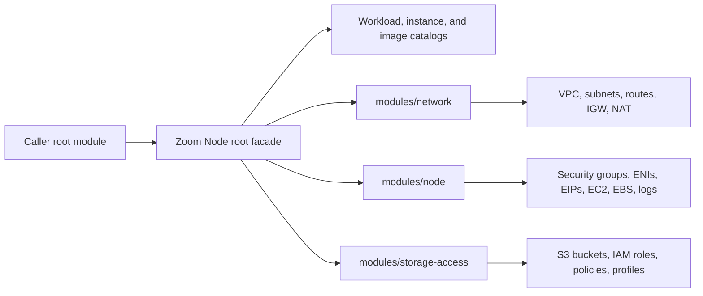

# Architecture

The repository root is the public module. It presents one portable Zoom Node contract and delegates AWS resource ownership to three private implementation modules.

Consumers should call only the repository root. The child modules are implementation details and do not carry an independent compatibility promise.

## Root facade

The facade owns:

- validation and deprecation warnings;
- workload and instance catalog loading;
- node-count calculation and deterministic node keys;
- private-IP, subnet, image, NIC, purchase-option, and timeout normalization;
- workload-specific ingress and egress rule generation;
- capacity-preflight requests and public outputs;
- retained `moved` blocks for internal resource extraction.

Every standard workload, advanced node group, and explicit node is normalized into one node-record map before resource creation. This keeps EC2, ENI, cloud-init, EIP, logging, and output behavior consistent across all interfaces.

## Network module

`modules/network` creates VPC resources only when `network_mode = "create_new"`. Depending on the selected topology, it can own the VPC, public and private subnets, internet gateway, route tables, and a single NAT Gateway in the first public subnet.

With `network_mode = "use_existing"`, the caller owns VPC routing, subnets, internet/NAT access, DNS behavior, and network ACLs.

## Node module

`modules/node` owns workload security groups and standalone rules, primary ENIs with deterministic private-IP lists, Elastic IPs and associations, EC2 instances, encrypted root volumes, source/destination checking, IMDSv2 settings, cloud-init, and CloudWatch log groups.

Stable keys such as `meetings_hybrid-01` identify per-node resources. Renaming a key changes Terraform identity and can destroy the old node unless a reviewed `moved` block accompanies the rename.

## Storage-access module

`modules/storage-access` manages optional S3 buckets and bucket controls plus IAM roles, granular policies, and instance profiles. Multiple advanced groups can share a profile key. Existing buckets remain externally owned except for the access policy attached to module-managed roles.

## Catalogs

| Catalog | Purpose |
|---|---|
| `workload-catalog.json` | Capacity formulas, default resources, address offsets, and provider recommendations |
| `instance-catalog.json` | Exact EC2 instance-type to guest-interface-name mapping |
| `image-catalog.json` | Deliberately empty reusable AMI catalog; customers supply private image IDs |

Maintained deployments may use their own deployment-scoped AMI catalog. That catalog is operational configuration and is not a fallback for external module consumers.

## Ownership boundaries

The module does not own DNS records, the Terraform backend, private AMI distribution, Zoom-side registration, existing VPC routing, external security groups, external IAM instance profiles, or customer-managed KMS key policies. These boundaries let customers integrate the module into their existing cloud governance model without transferring ownership implicitly.
